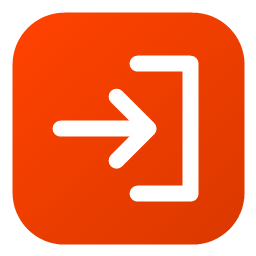
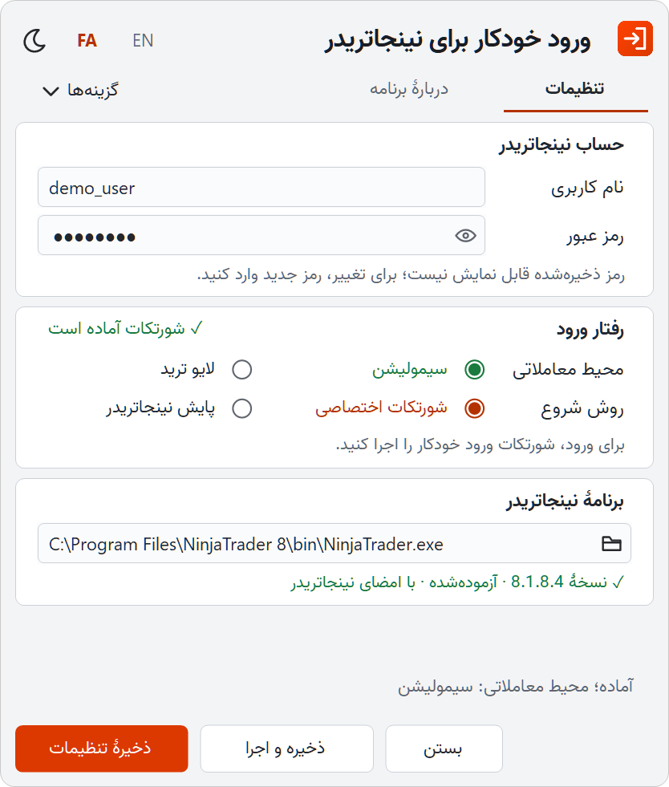
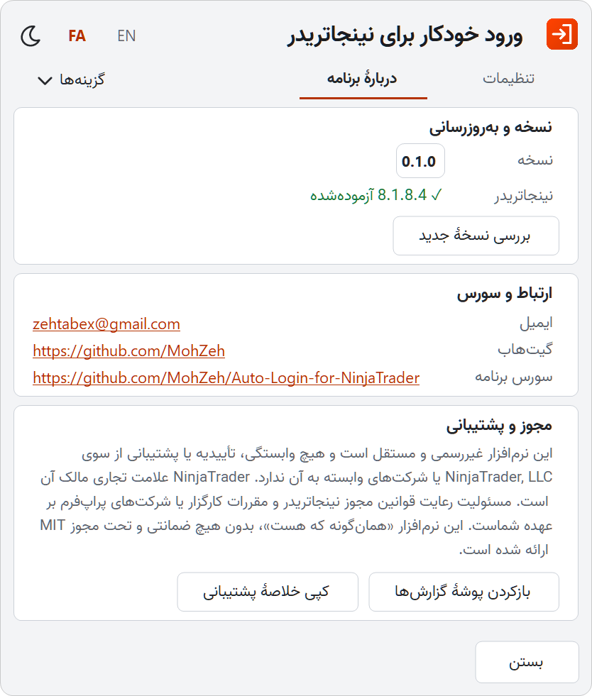

# ورود خودکار برای نینجاتریدر

**بدون تایپ دوبارهٔ رمز، در ویندوز به نینجاتریدر ۸ وارد شوید و مستقیم در سیمولیشن یا لایو باشید.**

[English](https://github.com/MohZeh/Auto-Login-for-NinjaTrader/blob/main/README.md) · [شروع کار](https://github.com/MohZeh/Auto-Login-for-NinjaTrader/blob/main/docs/fa/getting-started.md) · [استفادهٔ روزمره](https://github.com/MohZeh/Auto-Login-for-NinjaTrader/blob/main/docs/fa/usage.md) · [عیب‌یابی](https://github.com/MohZeh/Auto-Login-for-NinjaTrader/blob/main/docs/fa/troubleshooting.md) · [دانلود](https://github.com/MohZeh/Auto-Login-for-NinjaTrader/releases)

<picture>
  <source media="(prefers-color-scheme: dark)" srcset="https://raw.githubusercontent.com/MohZeh/Auto-Login-for-NinjaTrader/main/docs/images/setup-fa.png">
  
</picture>
<picture>
  <source media="(prefers-color-scheme: dark)" srcset="https://raw.githubusercontent.com/MohZeh/Auto-Login-for-NinjaTrader/main/docs/images/about-fa.png">
  
</picture>

> **نرم‌افزار غیررسمی:** این یک پروژهٔ مستقل است و هیچ وابستگی، تأییدیه یا پشتیبانی از سوی NinjaTrader, LLC ندارد. پیش از استفاده [اطلاعیهٔ حقوقی](#legal-notice) را بخوانید و خودتان تصمیم بگیرید.

این برنامه رمز نینجاتریدر شما را در مخزن اطلاعات ورود ویندوز (Credential Manager) نگه می‌دارد، صفحهٔ ورود نینجاتریدر را برایتان پر می‌کند و محیطی را که انتخاب کرده‌اید برمی‌گزیند. سفارشی ثبت نمی‌کند، استراتژی‌ای را فعال نمی‌کند و چیز دیگری را در نینجاتریدر تغییر نمی‌دهد.

## نصب

1. فایل `NinjaTraderAutoLogin-<version>-win-x64.zip` را از صفحهٔ [Releases](https://github.com/MohZeh/Auto-Login-for-NinjaTrader/releases) دانلود کنید و کل پوشه را در جایی ثابت از حالت فشرده خارج کنید.
2. فایل `NinjaTraderAutoLogin.exe` را باز کنید. اگر ویندوز هشدار SmartScreen داد، **More info** و سپس **Run anyway** را بزنید.
3. نام کاربری و رمز نینجاتریدر را وارد کنید، **سیمولیشن** یا **لایو ترید** و روش شروع را انتخاب کنید.
4. **ذخیرهٔ تنظیمات** را بزنید. اگر روش شورتکات را انتخاب کرده‌اید، **ساخت شورتکات** را هم بزنید.

**[راهنمای گام‌به‌گام](https://github.com/MohZeh/Auto-Login-for-NinjaTrader/blob/main/docs/fa/getting-started.md)** مسیر را از دانلود تا اولین ورود خودکار توضیح می‌دهد. در هر گام نوشته شده است که چه چیزی باید ببینید و اگر چیز دیگری دیدید، چه کنید.

## چرا این برنامه

- **دو روش شروع.** یا روی یک شورتکات دسکتاپ دوبار کلیک کنید، یا نینجاتریدر را مثل همیشه باز کنید تا برنامه از کنار ساعت ویندوز وارد شود.
- **رمز شما محافظت می‌شود.** رمز در مخزن اطلاعات ورود ویندوز می‌ماند، فقط به فایلی داده می‌شود که امضای معتبر نینجاتریدر را دارد و پس از ذخیره دیگر نمایش داده نمی‌شود.
- **به‌جای حدس‌زدن، متوقف می‌شود.** رمزی که پذیرفته نشده دوباره فرستاده نمی‌شود، پنجرهٔ ناشناخته یا تأیید اضافه کار را به خود شما می‌سپارد و لایو همیشه اول تأیید می‌خواهد.

## قابلیت‌ها

**ورود**
- پر کردن صفحهٔ ورود نینجاتریدر و انتخاب سیمولیشن یا لایو
- شورتکات اختصاصی: در صورت نیاز نینجاتریدر را باز می‌کند و پنجرهٔ کوچکی با دکمهٔ لغو نشان می‌دهد
- پایش نینجاتریدر: با ویندوز اجرا می‌شود، کنار ساعت منتظر می‌ماند و وقتی نینجاتریدر باز شد، وارد می‌شود

**ایمنی**
- بررسی امضای دیجیتال و نسخهٔ نینجاتریدر پیش از فرستادن هر چیزی
- نگه‌داشتن ورودِ پذیرفته‌نشده تا وقتی رمز را دوباره وارد کنید یا تلاش دوباره را تأیید کنید، چون تلاش‌های پشت‌سرهم ممکن است حساب را قفل کند
- تأیید پیش از رفتن به لایو، و تأیید جداگانه برای پایش همراه با لایو

**استفادهٔ روزمره**
- فارسی و انگلیسی، با تم روشن و تیره
- توقف موقت، ادامه یا خروج از خود پنجره یا آیکون کنار ساعت
- بررسی نسخهٔ جدید فقط با دستور شما، با لینک به صفحهٔ انتشار؛ برنامه هیچ‌وقت خودش چیزی دانلود یا نصب نمی‌کند
- خلاصهٔ پشتیبانی قابل کپی، بدون رمز، نام کاربری و مسیر فایل‌ها

## نیازمندی‌ها و سازگاری

| مورد | شرط |
|---|---|
| ویندوز | ویندوز ۱۰ یا ۱۱، ۶۴ بیتی، با ‎.NET Framework 4.8 (در ویندوز ۱۰ نسخهٔ 1903 و بعد از آن از قبل نصب است) |
| نینجاتریدر | نینجاتریدر ۸، که جداگانه نصب شده و امضای NinjaTrader, LLC را دارد. روی نسخهٔ **8.1.8.4** آزموده شده است. روی نسخه‌های دیگر، سیمولیشن با یک اعلان ادامه می‌یابد و لایو برای هر نسخه یک بار تأیید می‌خواهد. |
| ورود | ورود معمولی با نام کاربری و رمز. اگر نینجاتریدر تأیید اضافه بخواهد، باید آن را خودتان در پنجرهٔ نینجاتریدر انجام دهید. |
| لایو | **هنوز با حساب واقعی آزموده نشده است.** انتخاب لایو در برنامه به این معنی نیست که لایو آزموده شده است. اگر گزینهٔ لایو نینجاتریدر پیشنهاد ساخت حساب بدهد، برنامه بدون انتخاب آن متوقف می‌شود. |

نسخهٔ 0.1.0 به‌طور مستقیم آزموده شده است: تنظیمات، آیکون‌ها و ورود به سیمولیشن، هم با شورتکات اختصاصی و هم با پایش نینجاتریدر، همراه با رکوردهای اجرای مطابق.

## حریم خصوصی و امنیت

- رمز در مخزن اطلاعات ورود ویندوز نگه‌داری می‌شود، نه در فایل تنظیمات یا پوشهٔ برنامه.
- رمز ذخیره‌شده هیچ‌وقت دوباره در پنجره بارگذاری نمی‌شود؛ دکمهٔ چشم فقط رمز تازه‌ای را نشان می‌دهد که همین حالا تایپ کرده‌اید.
- رمز هیچ‌وقت از آرگومان‌های فرمان، متغیرهای محیطی، کلیپ‌بورد، لاگ‌ها یا پیام‌های بین پردازه‌های برنامه عبور نمی‌کند.
- برنامه‌هایی که با همان کاربر ویندوز اجرا می‌شوند، ممکن است دسترسی مشابهی به مخزن اطلاعات ورود داشته باشند. پنهان‌بودن رمز در پنجره این را تغییر نمی‌دهد.
- گزارش‌های تشخیصی محلی ممکن است مسیرهای سیستم و پردازه‌ها را داشته باشند. پیش از اشتراک‌گذاری آن‌ها را بررسی کنید و اطلاعات حساب را هرگز منتشر نکنید.

جزئیات کامل مرزهای امنیتی و روش گزارش آسیب‌پذیری در [SECURITY.md](SECURITY.md) (انگلیسی) آمده است.

## راهنماها

| راهنما | کاربرد |
|---|---|
| [شروع کار](https://github.com/MohZeh/Auto-Login-for-NinjaTrader/blob/main/docs/fa/getting-started.md) | از دانلود تا اولین ورود خودکار |
| [استفادهٔ روزمره](https://github.com/MohZeh/Auto-Login-for-NinjaTrader/blob/main/docs/fa/usage.md) | روش‌های شروع، لایو، تغییر رمز، شورتکات‌ها، نسخهٔ جدید، جابه‌جایی و حذف برنامه |
| [عیب‌یابی](https://github.com/MohZeh/Auto-Login-for-NinjaTrader/blob/main/docs/fa/troubleshooting.md) | معنی هر پیام و کاری که باید بکنید |
| [امنیت (انگلیسی)](SECURITY.md) | محافظت از رمز و گزارش آسیب‌پذیری |

## اطلاعیهٔ حقوقی

**نبود وابستگی.** این نرم‌افزار غیررسمی و مستقل است و هیچ وابستگی به NinjaTrader, LLC یا شرکت‌های وابسته به آن ندارد و از سوی آن‌ها تأیید، حمایت یا پشتیبانی نمی‌شود. NinjaTrader علامت تجاری مالک آن است و نامش فقط برای معرفی نرم‌افزاری آمده است که این برنامه با آن کار می‌کند. خود نینجاتریدر همراه این برنامه نیست.

**مسئولیت شما.** قرارداد مجوز نینجاتریدر، از جمله، دورزدن ابزارها و سازوکارهای امنیتی را منع می‌کند و اجازه می‌دهد پس از نقض قرارداد، دسترسی تعلیق یا قطع شود. ورود خود نینجاتریدر رمز را ذخیره نمی‌کند و کارکنان آن این را یک تصمیم امنیتی دانسته‌اند. نینجاتریدر این برنامه را بررسی یا تأیید نکرده است و ادعایی دربارهٔ سازگاری استفاده از آن با این قرارداد وجود ندارد. قرارداد و قوانین کارگزار یا شرکت پراپ خود را بخوانید و خودتان تصمیم بگیرید که آیا می‌توانید از این برنامه استفاده کنید. پیامد این تصمیم، از جمله اثر آن بر حساب شما، فقط با خود شماست.

**نبود ضمانت.** این نرم‌افزار «همان‌گونه که هست» و بدون هیچ ضمانتی ارائه می‌شود و طبق [مجوز MIT](LICENSE)، سازندگان مسئول هیچ ادعا یا خسارتی، از جمله زیان معاملاتی، نیستند. این نرم‌افزار توصیهٔ مالی یا حقوقی نیست.

## مجوز و ارتباط

کد و مستندات برنامه تحت مجوز [MIT](LICENSE) است. فونت وزیر تحت مجوز SIL Open Font License 1.1 همراه برنامه آمده است؛ [THIRD-PARTY-NOTICES.md](THIRD-PARTY-NOTICES.md) را ببینید. برای ساخت برنامه از سورس، بخش Build and check در [README انگلیسی](https://github.com/MohZeh/Auto-Login-for-NinjaTrader/blob/main/README.md#build-and-check) را ببینید.

[پروفایل گیت‌هاب](https://github.com/MohZeh) · [ایمیل](mailto:zehtabex@gmail.com)

