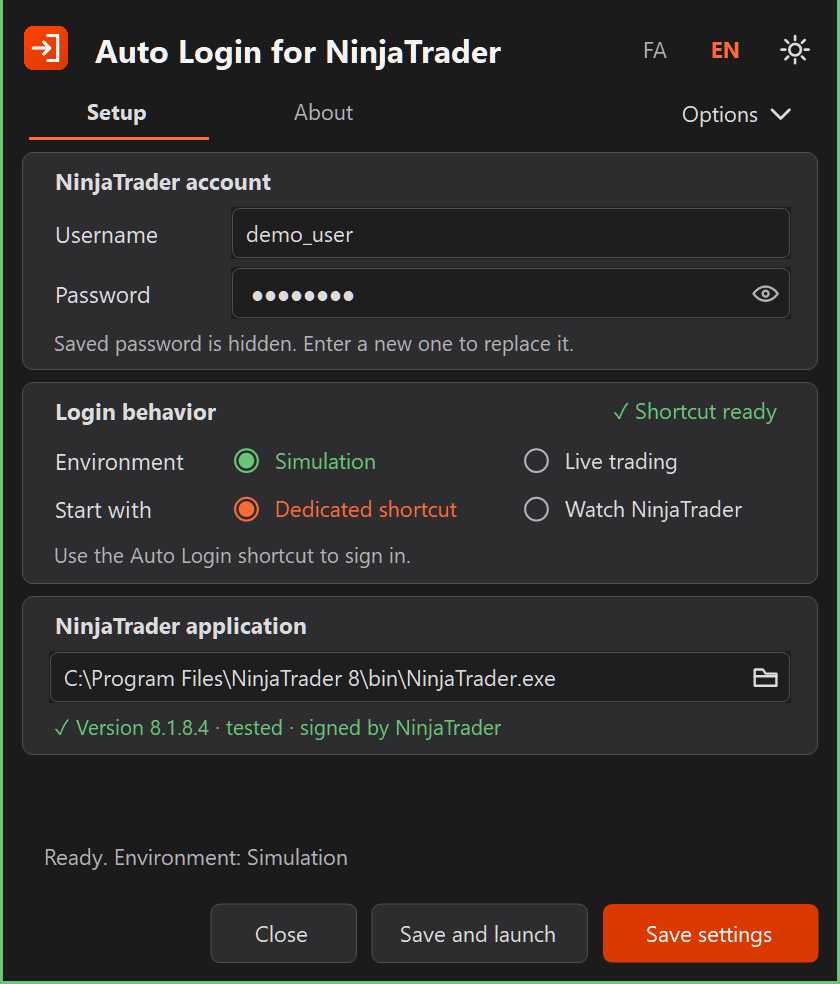
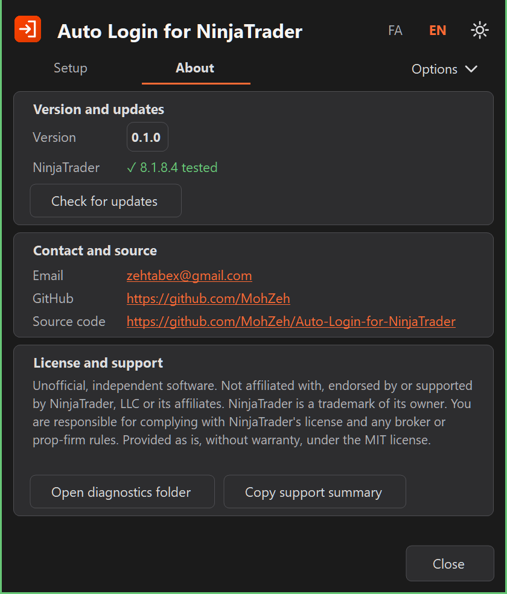
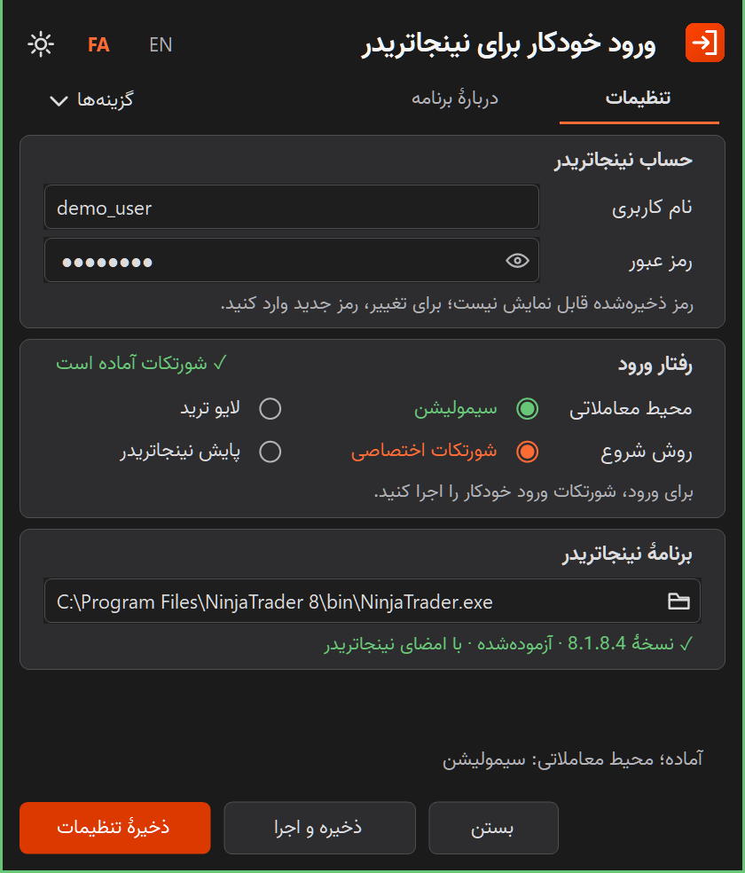

# Auto Login for NinjaTrader

> **Unofficial software.** Auto Login for NinjaTrader is an independent third-party project.
> It is not affiliated with, endorsed by, sponsored by or supported by NinjaTrader, LLC or
> its affiliates. NinjaTrader is a trademark of its owner and is named here only to identify
> the software this app works with. See the [legal notice](#legal-notice) before using it.

An open-source Windows app for signing in to NinjaTrader 8. Use a dedicated shortcut or
watch normal NinjaTrader launches, then enter the saved Simulation or Live environment.
The app does not place orders or enable strategies.

[Downloads](https://github.com/MohZeh/Auto-Login-for-NinjaTrader/releases) ·
[Security](SECURITY.md) · [MIT license](LICENSE) · [راهنمای فارسی](#راهنمای-فارسی)

 

## Requirements and compatibility

- Windows 10/11 x64 with .NET Framework 4.8.
- NinjaTrader 8 installed separately and signed by NinjaTrader, LLC. Tested on
  NinjaTrader 8.1.8.4. On another version, Simulation continues with a notice and
  Live asks once for that version.
- Ordinary username/password login. Additional verification requires manual attention.
- Release candidate 0.1.0-rc.1 has direct acceptance testing for settings, icons and
  Simulation sign-in through both the dedicated shortcut and watching NinjaTrader,
  backed by matching runtime records.
- **Live login has not been validated with a real account.** Selecting Live in the
  interface is not a claim of tested Live compatibility.
- Moving to Live asks for confirmation when saving, and enabling watching NinjaTrader
  with Live is confirmed separately. If NinjaTrader's Live option offers to open an
  account, the app stops without selecting it.

Compatibility with other versions depends on their login controls.

## Legal notice

**No affiliation.** This is an unofficial, independent third-party project. It is not
affiliated with, endorsed by, sponsored by or supported by NinjaTrader, LLC or its
affiliates. NinjaTrader is a trademark of its owner. The name is used only to identify the
software this app works with, and no trademark rights are claimed. NinjaTrader itself is
not included.

**Your responsibility.** NinjaTrader's license agreement, among other terms, prohibits
bypassing security devices or protections and allows access to be suspended or disabled
after a breach. NinjaTrader's own sign-in does not save your password, and its staff have
described that as a security decision. NinjaTrader has not reviewed or approved this app,
and no statement is made that using it complies with that agreement. Read the agreement and
any broker or prop-firm rules that apply to you, and decide for yourself whether you may
use this app. The consequences of that decision, including any effect on your account, are
yours alone.

**No warranty.** The software is provided "as is", without warranty of any kind, and the
authors are not liable for any claim or damage, including trading losses, as set out in the
[MIT license](LICENSE). It is not financial or legal advice.

## Quick start

1. Download the Windows x64 ZIP from [Releases](https://github.com/MohZeh/Auto-Login-for-NinjaTrader/releases)
   and extract the entire folder.
2. Put the folder in a location where your Windows user can run applications. Keep
   the executable, config, shortcut icons and license files together.
3. Open `NinjaTraderAutoLogin.exe`. It is not code-signed, so Windows SmartScreen may
   warn you. If you trust this source, select **More info**, then **Run anyway**.
4. Under **NinjaTrader account**, enter your username and password.
5. Under **Login behavior**, select **Simulation** or **Live trading** and a start
   method. Simulation is the default. For **Dedicated shortcut**, select
   **Create shortcut** to add it to your desktop.
6. Under **NinjaTrader application**, check the path. The line below it shows the
   version and whether the file is signed by NinjaTrader.
7. Select **Save settings** or **Save and launch**.

To verify a download, compare it with the release's `.sha256` file, or confirm that
GitHub built it from this repository:

```powershell
gh attestation verify .\NinjaTraderAutoLogin-<version>-win-x64.zip --repo MohZeh/Auto-Login-for-NinjaTrader
```

The app first opens in Persian when Windows uses Persian and in English otherwise.
It offers Persian/English, Light/Dark themes, an embedded Vazir font and an
About page with version, contact links and an on-demand update check.

### Start methods

- **Dedicated shortcut:** use the Auto Login shortcut or `--launch`. The app
  launches NinjaTrader if needed, shows a small progress window with a cancel button,
  and closes after the operation when no settings window or watching session needs
  to remain open.
- **Watch NinjaTrader:** starts with Windows after you save this mode, stays in the
  tray and detects NinjaTrader launched normally. Turning on watching does not
  launch NinjaTrader. If NinjaTrader is already open when you save, the app asks first.
  Use **Options** or the tray menu to pause/resume or exit.

Both methods share one coordinator. An already-open main window is reported as
already open; its trading environment is not changed. Unknown controls, extra
verification, login errors or timeouts stop the operation for manual attention.

### Create or repair shortcuts

Use **Create shortcut** in the application. It adds **Auto Login for NinjaTrader** and
**Auto Login for NinjaTrader Settings** to your desktop. To manage them from a script instead,
run this in PowerShell from the extracted folder:

```powershell
./setup-shortcuts.ps1
```

This creates the same two shortcuts in the
application folder and on your Desktop. Shortcuts with the previous product name are
replaced. Launch uses the executable's embedded
icon; Settings uses the included settings icon. Existing shortcuts belonging to
other applications are preserved. The script does not launch the app.

From a source checkout, use `./scripts/setup-shortcuts.ps1` after building. It
creates the shortcuts in the checkout root and on your Desktop.

### Move or upgrade the app

1. Exit the app through **Options → Exit** or the tray menu; closing a settings
   window alone keeps watching active.
2. Move the extracted folder, or extract a newer release into its final location.
3. Run the executable once from the new location. A startup command recognized as
   this app's moves to the new location only if its old file no longer exists;
   otherwise save Watch NinjaTrader from the new copy. A manually removed startup entry is
   not recreated unless you save Watch NinjaTrader again.
4. Select **Update shortcut** in the application to repair the two owned shortcuts.

Settings remain under `%LOCALAPPDATA%\NinjaTraderAutoLogin`, and saved credentials
remain in the current user's Windows Credential Manager. They are not stored in
the application folder or carried to another computer/user by copying the ZIP.
Use ordinary Windows paths; system permissions, execution policies and platform
path-length limits still apply.

### Passwords and privacy

- Passwords are stored using Windows Credential Manager, not in the settings file.
- Saved passwords show a fixed decorative mask. They are not loaded into the
  settings editor; the eye only previews a new, unsaved password.
- Leave the password editor empty to keep the saved password. Enter a new password
  and save to replace it. **Options → Remove saved login** removes the credential.
- Passwords do not go through command arguments, environment variables, clipboard,
  logs or worker messages. The app retrieves the password when sign-in needs it.
- Programs running as the same Windows user may have comparable vault access.
  Hiding the saved password in settings does not change that Windows policy.
- Local diagnostics keep the latest 50 login records and 20 fault records. They may
  contain system/process paths. Keep them private and review
  reports and screenshots before sharing. Never post account details or raw captures.

See [SECURITY.md](SECURITY.md) for the process and credential boundaries.

### Updates, troubleshooting and removal

**About → Check for updates** contacts this project's public GitHub release API only
when you select it. The result appears beside the button. If a newer version exists, it
appears as a link to its release page, where you download the new ZIP yourself. The app
never downloads, installs or runs an update on its own, because it handles your password
and is not code-signed. Pre-releases, such as release candidates, are not offered.

If sign-in stops, check the NinjaTrader path and the displayed status. A file that is
not signed by NinjaTrader never receives your password. If NinjaTrader refuses a login, the
Setup page keeps a warning and the password is not sent again until you enter it again or
confirm another attempt, because repeated attempts can lock an account. The login is not
deleted automatically, since the cause may be a locked account or a failed connection; the
warning offers **Remove saved login**. To report a problem, use **About → Copy support summary**;
it has no password, username or file paths. **Open diagnostics folder** shows the full
local reports. Additional
verification and an unsupported login window need manual attention. Do not run a
second copy to force another attempt. Pause watching before investigating.

To remove the app, save **Dedicated shortcut** mode, remove the saved login if
desired, and exit the app. Run `./setup-shortcuts.ps1 -Remove` to remove its two
owned shortcuts, then delete the extracted folder. Optional local diagnostic and
settings data remain under the user data folder above.

## Build and check

Install the .NET 10 SDK on Windows. `global.json` selects a compatible stable
feature band; the first locked restore downloads Microsoft's .NET Framework
reference assemblies. NinjaTrader and account credentials are not needed.

```powershell
./build.ps1
./scripts/test.ps1 -NoBuild
./scripts/check-repository.ps1
./scripts/test-packaging.ps1
./scripts/test-portability.ps1
dotnet format NinjaTraderLogin.sln --no-restore --verify-no-changes
./scripts/package.ps1 -NoBuild
```

Builds and reports stay under ignored `artifacts/`; the deployed application is
not overwritten. Tests use fakes and workspace fixtures, without accessing the
credential vault or a real NinjaTrader. They also drive a test window with NinjaTrader's
control ids through real UI Automation on a private desktop. CI repeats these checks on
Windows, and pushing a `v*` tag builds, attests and publishes the release from CI.
A calculated layout check does not establish behavior on every physical monitor.

The versioned ZIP includes only the runtime files, shortcut setup, this guide,
security information and required licenses. Packaging verifies the exact build,
checks the ZIP entry list and scans for host paths and common secret patterns.
An existing versioned ZIP is never overwritten. Scanning is a limited safeguard,
not a guarantee that arbitrary sensitive data can always be identified.

## License and contact

Original application code and documentation: [MIT](LICENSE), copyright 2026 MohZeh.
Vazir: SIL Open Font License 1.1, retained separately; see
[THIRD-PARTY-NOTICES.md](THIRD-PARTY-NOTICES.md).

[GitHub profile](https://github.com/MohZeh) · [Email](mailto:zehtabex@gmail.com)

## راهنمای فارسی

‏این برنامه یک نرم‌افزار متن‌باز برای ورود به نینجاتریدر ۸ در ویندوز است. سفارش ثبت نمی‌کند و استراتژی‌ها را فعال نمی‌کند. محیط سیمولیشن و لایو قابل انتخاب‌اند؛ ورود لایو هنوز با حساب واقعی آزموده نشده است. رفتن به لایو هنگام ذخیره تأیید می‌خواهد و فعال‌کردن پایش همراه با لایو هم تأیید جدا دارد. اگر گزینهٔ لایو نینجاتریدر ساخت حساب را پیشنهاد کند، برنامه بدون انتخاب آن متوقف می‌شود.

‏این برنامه روی نینجاتریدر 8.1.8.4 آزموده شده است. روی نسخه‌های دیگر، سیمولیشن با اعلان ادامه می‌یابد و لایو برای هر نسخه یک بار تأیید می‌خواهد. رمز فقط به فایلی داده می‌شود که امضای معتبر نینجاتریدر را داشته باشد.

### اطلاعیهٔ حقوقی

‏**نبود وابستگی:** این نرم‌افزار غیررسمی و مستقل است و هیچ وابستگی به NinjaTrader, LLC یا شرکت‌های وابسته به آن ندارد و از سوی آن‌ها تأیید، حمایت یا پشتیبانی نمی‌شود. NinjaTrader علامت تجاری مالک آن است و نام آن فقط برای معرفی نرم‌افزار سازگار به کار رفته است.

‏**مسئولیت کاربر:** قرارداد مجوز نینجاتریدر از جمله دورزدن ابزارها و سازوکارهای امنیتی را منع می‌کند و اجازه می‌دهد پس از نقض قرارداد، دسترسی تعلیق یا قطع شود. نینجاتریدر این برنامه را بررسی یا تأیید نکرده است و ادعایی دربارهٔ سازگاری آن با این قرارداد وجود ندارد. قرارداد و قوانین کارگزار یا شرکت پراپ خود را بخوانید و خودتان تصمیم بگیرید. پیامد این تصمیم، از جمله اثر آن بر حساب شما، با خود شماست.

‏**نبود ضمانت:** این نرم‌افزار «همان‌گونه که هست» و بدون هیچ ضمانتی ارائه می‌شود و طبق [مجوز MIT](LICENSE)، سازندگان مسئول هیچ ادعا یا خسارتی، از جمله زیان معاملاتی، نیستند. این نرم‌افزار توصیهٔ مالی یا حقوقی نیست.



### شروع استفاده

- ‏فایل زیپ را از بخش Releases بگیرید، کامل استخراج کنید و تمام محتویات پوشه را کنار هم نگه دارید.
- ‏فایل ⁦`NinjaTraderAutoLogin.exe`⁩ را باز کنید. این فایل امضای دیجیتال ندارد و ویندوز ممکن است هشدار SmartScreen بدهد؛ اگر به این منبع اعتماد دارید، More info و بعد Run anyway را بزنید.
- ‏نام کاربری و رمز را وارد کنید، محیط و روش شروع را انتخاب کنید، مسیر نینجاتریدر را بررسی و ذخیره کنید. برای ساخت شورتکات، در همان بخش «ساخت شورتکات» را بزنید.
- ‏در روش شورتکات، از شورتکات ورود خودکار استفاده کنید. در روش پایش، نینجاتریدر را به شکل معمول اجرا کنید؛ برنامه در کنار ساعت در دسترس است.
- ‏اگر ترجیح می‌دهید از اسکریپت استفاده کنید، دستور ⁦`./setup-shortcuts.ps1`⁩ را از پاورشل همان پوشه اجرا کنید. این دستور برنامه را اجرا نمی‌کند.

### رمز، جابجایی و حذف

‏رمز در مخزن اطلاعات ورود ویندوز نگهداری می‌شود. دایره‌های کادر رمز فقط وجود رمز ذخیره‌شده را نشان می‌دهند؛ چشم فقط برای رمز تازه‌ای که هنوز ذخیره نشده فعال است. خالی‌گذاشتن کادر، رمز قبلی را حفظ می‌کند. حذف اطلاعات ورود از منوی «گزینه‌ها» در دسترس است.

‏برای جابجایی یا ارتقا، ابتدا از منوی برنامه یا آیکون کنار ساعت خارج شوید. پوشه را منتقل کنید و برنامه را یک بار از محل جدید باز کنید تا مسیر ثبت‌شدهٔ پایش اصلاح شود. سپس اسکریپت ساخت شورتکات را دوباره اجرا کنید. تنظیمات و رمز روی همان کاربر ویندوز باقی می‌مانند و همراه زیپ به کاربر یا کامپیوتر دیگر منتقل نمی‌شوند.

‏برای حذف، روش شورتکات را انتخاب و ذخیره کنید؛ در صورت تمایل اطلاعات ورود را حذف کنید و از برنامه خارج شوید. دستور ⁦`./setup-shortcuts.ps1 -Remove`⁩ شورتکات‌های متعلق به برنامه را حذف می‌کند؛ سپس می‌توانید پوشهٔ برنامه را پاک کنید.

‏بخش «دربارهٔ برنامه» نسخه، راه‌های تماس، بررسی دستی نسخهٔ جدید و ابزار پشتیبانی را نشان می‌دهد. اگر نسخهٔ جدیدی باشد، کنار دکمه جمله‌ای می‌آید که با کلیک روی آن صفحهٔ دانلود باز می‌شود و فایل را خودتان می‌گیرید؛ برنامه هیچ‌وقت خودش را دانلود یا نصب نمی‌کند، چون با رمز شما کار می‌کند و امضای دیجیتال ندارد. اگر نینجاتریدر ورود را نپذیرد، هشدار در صفحهٔ تنظیمات می‌ماند و رمز تا وقتی دوباره وارد یا تأیید نکنید ارسال نمی‌شود. اطلاعات ورود خودکار حذف نمی‌شود، چون علت ممکن است قفل‌بودن حساب یا قطع اتصال باشد؛ برای حذف، گزینهٔ «حذف اطلاعات ورود» کنار هشدار است. گزارش‌های محلی و تصاویر را پیش از اشتراک‌گذاری بررسی کنید تا مسیرهای شخصی و اطلاعات حساب منتشر نشوند.
