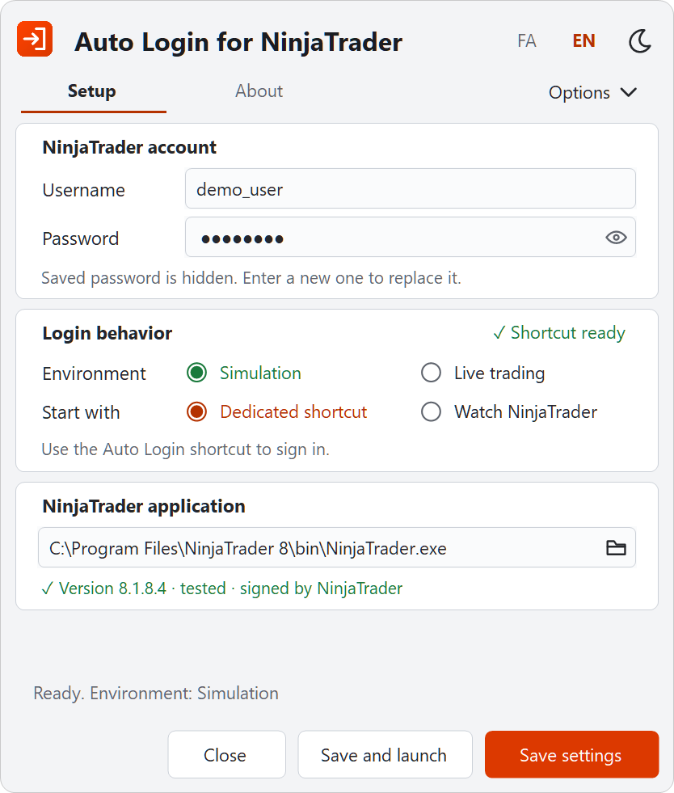
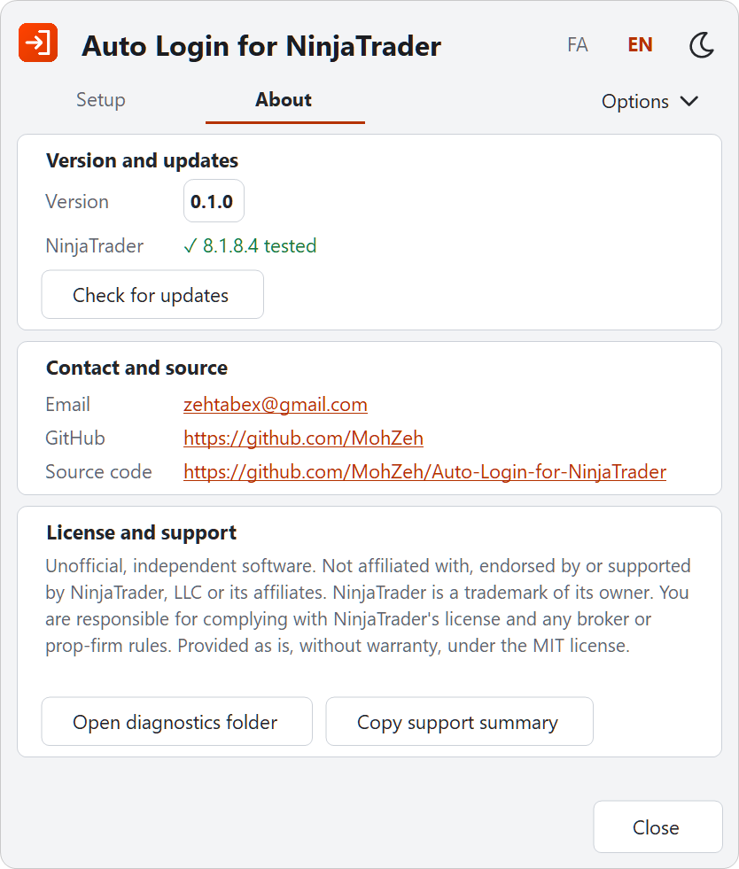

<div align="center">


# Auto Login for NinjaTrader

**Sign in to NinjaTrader 8 on Windows and land in Simulation or Live, without typing your password each time.**

[](https://github.com/MohZeh/Auto-Login-for-NinjaTrader/actions/workflows/ci.yml) [](https://github.com/MohZeh/Auto-Login-for-NinjaTrader/releases) [](LICENSE) 

[فارسی](https://github.com/MohZeh/Auto-Login-for-NinjaTrader/blob/main/README.fa.md) · [Getting started](https://github.com/MohZeh/Auto-Login-for-NinjaTrader/blob/main/docs/en/getting-started.md) · [Everyday use](https://github.com/MohZeh/Auto-Login-for-NinjaTrader/blob/main/docs/en/usage.md) · [Troubleshooting](https://github.com/MohZeh/Auto-Login-for-NinjaTrader/blob/main/docs/en/troubleshooting.md) · [Download](https://github.com/MohZeh/Auto-Login-for-NinjaTrader/releases)

<picture>
  <source media="(prefers-color-scheme: dark)" srcset="https://raw.githubusercontent.com/MohZeh/Auto-Login-for-NinjaTrader/main/docs/images/setup-en.png">
  
</picture>
<picture>
  <source media="(prefers-color-scheme: dark)" srcset="https://raw.githubusercontent.com/MohZeh/Auto-Login-for-NinjaTrader/main/docs/images/about-en.png">
  
</picture>

</div>

> [!IMPORTANT]
> **Unofficial software.** This is an independent project, not affiliated with, endorsed by or supported by NinjaTrader, LLC. Read the [legal notice](#legal-notice) and decide for yourself whether you may use it.

Auto Login for NinjaTrader keeps your NinjaTrader password in Windows Credential Manager and fills in the sign-in window for you, then selects the environment you chose. It does not place orders, enable strategies or change anything else in NinjaTrader.

## Install

1. Download `NinjaTraderAutoLogin-<version>-win-x64.zip` from [Releases](https://github.com/MohZeh/Auto-Login-for-NinjaTrader/releases) and extract the whole folder to a permanent place.
2. Open `NinjaTraderAutoLogin.exe`. If Windows SmartScreen warns you, select **More info**, then **Run anyway**.
3. Enter your NinjaTrader username and password, choose **Simulation** or **Live trading**, and choose how to start.
4. Select **Save settings**. For the dedicated shortcut, select **Create shortcut** too.

**[Follow the step-by-step guide](https://github.com/MohZeh/Auto-Login-for-NinjaTrader/blob/main/docs/en/getting-started.md)**, from the download to your first automatic sign-in. Each step says what you should see and what to do if you see something else.

## Why Auto Login

- **Two ways to start.** Double-click one desktop shortcut, or open NinjaTrader as usual and let the app sign in from the notification area.
- **Your password stays protected.** It lives in Windows Credential Manager, goes only to a NinjaTrader file with NinjaTrader's valid signature, and is never shown again after saving.
- **It stops instead of guessing.** A rejected password is not sent again, an unknown window or extra verification hands control back to you, and Live always asks first.

## Features

**Sign-in**
- Fills in NinjaTrader's sign-in window and selects Simulation or Live
- Dedicated shortcut: opens NinjaTrader if needed and shows a small progress window with a cancel button
- Watch NinjaTrader: starts with Windows, waits in the notification area and signs in when NinjaTrader opens

**Safety**
- Checks NinjaTrader's digital signature and version before sending anything
- Holds a rejected login until you enter the password again or confirm another attempt, because repeated attempts can lock an account
- Asks for confirmation before switching to Live, and again before watching with Live

**Everyday use**
- Persian and English, light and dark themes
- Pause, resume or exit from the window or the notification area
- On-demand update check that links to the release page; the app never downloads or installs anything itself
- A support summary you can copy, without password, username or file paths

## Requirements and compatibility

| Item | Requirement |
|---|---|
| Windows | Windows 10 or 11, 64-bit, with .NET Framework 4.8 (included in Windows 10 version 1903 and later) |
| NinjaTrader | NinjaTrader 8, installed separately and signed by NinjaTrader, LLC. Tested on **8.1.8.4**. On another version, Simulation continues with a notice and Live asks once for that version. |
| Sign-in | Ordinary username and password. Additional verification needs you to finish it in NinjaTrader's window. |
| Live | **Not yet tested with a real account.** Selecting Live in the app is not a claim that Live works. If NinjaTrader's Live option offers to open an account, the app stops without selecting it. |

Version 0.1.0 has direct acceptance testing for settings, icons and Simulation sign-in through both the dedicated shortcut and watching NinjaTrader, backed by matching runtime records.

## Privacy and security

- The password is stored in Windows Credential Manager, not in the settings file or the app folder.
- A saved password is never loaded back into the window; the eye only previews a new password you have just typed.
- The password never goes through command arguments, environment variables, the clipboard, logs or messages between the app's processes.
- Programs running as the same Windows user may have similar access to Credential Manager. Hiding the password in the window does not change that.
- Local diagnostic records may contain system and process paths. Review them before sharing, and never post account details.

See [SECURITY.md](SECURITY.md) for the full process and credential boundaries and for reporting a vulnerability.

## Guides

| Guide | Use it for |
|---|---|
| [Getting started](https://github.com/MohZeh/Auto-Login-for-NinjaTrader/blob/main/docs/en/getting-started.md) | From the download to your first automatic sign-in |
| [Everyday use](https://github.com/MohZeh/Auto-Login-for-NinjaTrader/blob/main/docs/en/usage.md) | Start methods, Live, password changes, shortcuts, updates, moving and removing the app |
| [Troubleshooting](https://github.com/MohZeh/Auto-Login-for-NinjaTrader/blob/main/docs/en/troubleshooting.md) | What each message means and what to do |
| [Security](SECURITY.md) | How the password is protected, and reporting a vulnerability |

## Legal notice

**No affiliation.** This is an unofficial, independent third-party project. It is not affiliated with, endorsed by, sponsored by or supported by NinjaTrader, LLC or its affiliates. NinjaTrader is a trademark of its owner. The name is used only to identify the software this app works with, and no trademark rights are claimed. NinjaTrader itself is not included.

**Your responsibility.** NinjaTrader's license agreement, among other terms, prohibits bypassing security devices or protections and allows access to be suspended or disabled after a breach. NinjaTrader's own sign-in does not save your password, and its staff have described that as a security decision. NinjaTrader has not reviewed or approved this app, and no statement is made that using it complies with that agreement. Read the agreement and any broker or prop-firm rules that apply to you, and decide for yourself whether you may use this app. The consequences of that decision, including any effect on your account, are yours alone.

**No warranty.** The software is provided "as is", without warranty of any kind, and the authors are not liable for any claim or damage, including trading losses, as set out in the [MIT license](LICENSE). It is not financial or legal advice.

## Build and check

Install the .NET 10 SDK on Windows. `global.json` selects a compatible stable feature band; the first locked restore downloads Microsoft's .NET Framework reference assemblies. NinjaTrader and account credentials are not needed.

```powershell
./build.ps1
./scripts/test.ps1 -NoBuild
./scripts/check-repository.ps1
./scripts/test-packaging.ps1
./scripts/test-portability.ps1
dotnet format NinjaTraderLogin.sln --no-restore --verify-no-changes
./scripts/package.ps1 -NoBuild
```

Builds and reports stay under ignored `artifacts/`; the deployed application is not overwritten. Tests use fakes and workspace fixtures, without accessing the credential vault or a real NinjaTrader. They also drive a test window with NinjaTrader's control ids through real UI Automation on a private desktop. CI repeats these checks on Windows, and pushing a `v*` tag builds, attests and publishes the release from CI. With .NET SDK 10.0.403, a Release build of a release tag gives the same `NinjaTraderAutoLogin.exe` as the published ZIP; `./build.ps1` prints its SHA-256. A calculated layout check does not establish behavior on every physical monitor.

The versioned ZIP includes only the runtime files, shortcut setup, the English and Persian guides, security information and required licenses. Packaging verifies the exact build, checks the ZIP entry list and scans for host paths and common secret patterns. An existing versioned ZIP is never overwritten. Scanning is a limited safeguard, not a guarantee that arbitrary sensitive data can always be identified.

More detail: [architecture](docs/architecture.md), [development](docs/development.md) and [testing](docs/testing.md).

## License and contact

Original application code and documentation: [MIT](LICENSE), copyright 2026 MohZeh. Vazir: SIL Open Font License 1.1, retained separately; see [THIRD-PARTY-NOTICES.md](THIRD-PARTY-NOTICES.md).

[GitHub profile](https://github.com/MohZeh) · [Email](mailto:zehtabex@gmail.com)
