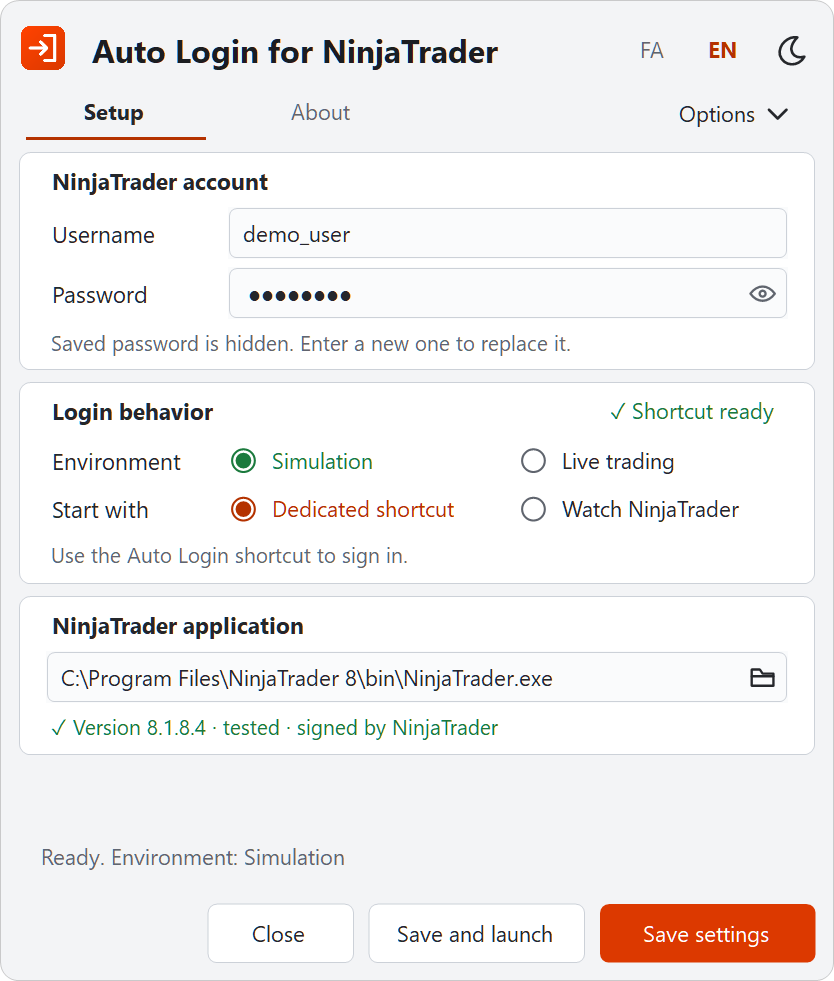

# Getting started

[Back to README](../../README.md) · [فارسی](../fa/getting-started.md)

This guide takes you from the download to your first automatic sign-in, in about five minutes. Each step says what you should see, and what to do if you see something else.

## Step 1: Check what you need

- Windows 10 or 11, 64-bit. .NET Framework 4.8 is already included in Windows 10 version 1903 and later.
- NinjaTrader 8, installed and working. Version 8.1.8.4 is tested.
- Your NinjaTrader username and password.

**Before you continue:** read the [legal notice](../../README.md#legal-notice). This app is not made or approved by NinjaTrader, and you decide whether you may use it.

## Step 2: Download the app

1. Open [Releases](https://github.com/MohZeh/Auto-Login-for-NinjaTrader/releases).
2. Under **Assets** of the newest version, select `NinjaTraderAutoLogin-<version>-win-x64.zip`.

**To check the download (optional):** the release also has a `.sha256` file. In PowerShell, run the command below in your Downloads folder and compare the result with that file.

```powershell
Get-FileHash .\NinjaTraderAutoLogin-<version>-win-x64.zip
```

## Step 3: Extract the folder to a permanent place

1. Right-click the ZIP and select **Extract All**.
2. Choose a folder you will keep, for example `C:\Tools\Auto Login for NinjaTrader`.

**Expected result:** a folder with `NinjaTraderAutoLogin.exe`, `NinjaTraderAutoLogin.exe.config`, `README.md`, `README.fa.md`, `setup-shortcuts.ps1` and the `assets` and `licenses` folders.

**Keep the files together.** Do not run the app from inside the ZIP, and do not move the `.exe` on its own. Shortcuts and watching point to this folder; to move it later, see [Move or upgrade the app](usage.md#move-or-upgrade-the-app).

## Step 4: Open the app

Double-click `NinjaTraderAutoLogin.exe`.

**If Windows shows "Windows protected your PC":** the app is not code-signed, so Windows SmartScreen does not recognize it. If you trust this source, select **More info**, then **Run anyway**. Windows asks only the first time.

**Expected result:** the **Setup** page opens. It is in Persian when Windows uses Persian and in English otherwise. Use **FA** or **EN** at the top to change the language, and the sun or moon icon to change the theme.

<p align="center">
<picture>
  <source media="(prefers-color-scheme: dark)" srcset="../images/setup-en.png">
  
</picture>
</p>

## Step 5: Enter your NinjaTrader account

Under **NinjaTrader account**, enter your **Username** and **Password**. The eye icon shows the password you have just typed, so you can check it.

**Expected result:** the line below says *Save to use this new password.*

## Step 6: Choose the environment

Under **Login behavior**, next to **Environment**:

- **Simulation** (default): signs in and selects Simulation.
- **Live trading**: signs in and selects your Live account. When you save, the app asks you to confirm. Live sign-in has not yet been tested with a real account.

## Step 7: Choose how to start

Next to **Start with**, choose one:

| Choose | If you want to | How you sign in afterwards |
|---|---|---|
| **Dedicated shortcut** | Decide each time when to sign in | Double-click the **Auto Login for NinjaTrader** shortcut on your desktop |
| **Watch NinjaTrader** | Keep opening NinjaTrader the way you always do | Open NinjaTrader normally; the app waits next to the clock and signs in |

You can change this later; see [Start methods](usage.md#start-methods).

## Step 8: Check the NinjaTrader path

Under **NinjaTrader application**, the app fills in the usual path:

```text
C:\Program Files\NinjaTrader 8\bin\NinjaTrader.exe
```

**Expected result:** a green line such as *✓ Version 8.1.8.4 · tested · signed by NinjaTrader*.

**If you see something else:**
- *✕ This file was not found.*: select the folder icon and choose `NinjaTrader.exe` from the `bin` folder of your NinjaTrader installation.
- *⚠ Version … has not been tested with this app.*: your NinjaTrader version is different. Simulation still works; Live asks once for this version.
- *✕ Not signed by NinjaTrader, so sign-in will stop.*: the file is not the original NinjaTrader program. Choose the real `NinjaTrader.exe`; the app never sends your password to an unsigned file.

## Step 9: Save

Select **Save settings**.

**With Dedicated shortcut:**
1. Select **Create shortcut** in the **Login behavior** section.
2. **Expected result:** *✓ Shortcut ready*, and two new icons on your desktop: **Auto Login for NinjaTrader** and **Auto Login for NinjaTrader Settings**.

**With Watch NinjaTrader:**
- **Expected result:** *Settings saved. Watching is active in the tray.* The app icon appears next to the clock. If you do not see it, select the **^** arrow to show hidden icons.
- If NinjaTrader is already open, the app first asks *Start watching now?* Select **Save and watch**.

## Step 10: Sign in for the first time

**With Dedicated shortcut:** double-click **Auto Login for NinjaTrader** on your desktop.

**Expected result:** a small window shows *Opening NinjaTrader…*, *Waiting for the sign-in window…* and *Signing in…*. NinjaTrader's sign-in window fills in by itself, the small window says, for example, *Simulation selected. NinjaTrader is open.*, and it closes after a few seconds. To stop a sign-in while it runs, select **Cancel** in the small window.

**With Watch NinjaTrader:** open NinjaTrader the way you always do.

**Expected result:** NinjaTrader's sign-in window fills in by itself and NinjaTrader opens in the environment you chose. No extra window appears. To stop a sign-in while it runs, right-click the app icon next to the clock and select **Cancel current login**.

**If something goes wrong:** the app stops and opens its settings window with a message at the bottom. Look the message up in [Troubleshooting](troubleshooting.md). The app never retries a rejected password by itself.

## Next steps

- Change the environment, password or start method: [Everyday use](usage.md)
- Something did not work: [Troubleshooting](troubleshooting.md)
