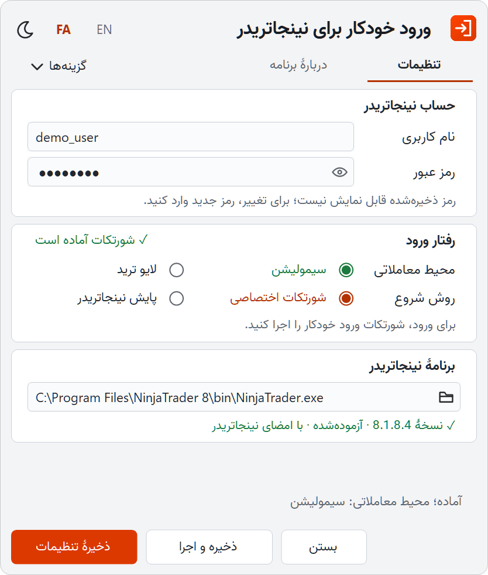

<div dir="rtl">

# شروع کار

[بازگشت به README](../../README.fa.md) · [English](../en/getting-started.md)

این راهنما شما را در حدود پنج دقیقه از دانلود تا اولین ورود خودکار می‌برد. در هر گام نوشته شده است که چه چیزی باید ببینید و اگر چیز دیگری دیدید، چه کنید.

## گام ۱: پیش‌نیازها را بررسی کنید

- ویندوز ۱۰ یا ۱۱، ۶۴ بیتی. ‎.NET Framework 4.8 در ویندوز ۱۰ نسخهٔ 1903 و بعد از آن از قبل نصب است.
- نینجاتریدر ۸، نصب‌شده و سالم. نسخهٔ 8.1.8.4 آزموده شده است.
- نام کاربری و رمز نینجاتریدر.

**پیش از ادامه:** [اطلاعیهٔ حقوقی](../../README.fa.md#legal-notice) را بخوانید. این برنامه ساخته یا تأییدشدهٔ نینجاتریدر نیست و تصمیم استفاده از آن با خود شماست.

## گام ۲: برنامه را دانلود کنید

1. صفحهٔ [Releases](https://github.com/MohZeh/Auto-Login-for-NinjaTrader/releases) را باز کنید.
2. در بخش **Assets** جدیدترین نسخه، فایل `NinjaTraderAutoLogin-<version>-win-x64.zip` را انتخاب کنید.

**بررسی دانلود (اختیاری):** کنار فایل زیپ، یک فایل `.sha256` هم منتشر شده است. دستور زیر را در PowerShell و در پوشهٔ Downloads اجرا کنید و نتیجه را با آن فایل مقایسه کنید.

</div>

```powershell
Get-FileHash .\NinjaTraderAutoLogin-<version>-win-x64.zip
```

<div dir="rtl">

## گام ۳: پوشه را در جایی ثابت از حالت فشرده خارج کنید

1. روی فایل زیپ راست‌کلیک کنید و **Extract All** را بزنید.
2. پوشه‌ای را انتخاب کنید که می‌خواهید نگه دارید، مثلاً `C:\Tools\Auto Login for NinjaTrader`.

**نتیجهٔ مورد انتظار:** پوشه‌ای با فایل‌های `NinjaTraderAutoLogin.exe`، `NinjaTraderAutoLogin.exe.config`، `README.md`، `README.fa.md` و `setup-shortcuts.ps1`، و پوشه‌های `assets` و `licenses`.

**فایل‌ها را کنار هم نگه دارید.** برنامه را از داخل خود زیپ اجرا نکنید و فایل `.exe` را تنها جابه‌جا نکنید. شورتکات‌ها و پایش به همین پوشه اشاره می‌کنند؛ برای جابه‌جایی بعدی، بخش [جابه‌جایی یا ارتقای برنامه](usage.md#move-or-upgrade) را ببینید.

## گام ۴: برنامه را باز کنید

روی `NinjaTraderAutoLogin.exe` دوبار کلیک کنید.

**اگر ویندوز پیام «Windows protected your PC» را نشان داد:** برنامه امضای دیجیتال ندارد و SmartScreen ویندوز آن را نمی‌شناسد. اگر به این منبع اعتماد دارید، **More info** و سپس **Run anyway** را بزنید. ویندوز فقط بار اول این را می‌پرسد. در ویندوز فارسی، نام این دکمه‌ها ممکن است فارسی باشد.

**نتیجهٔ مورد انتظار:** صفحهٔ **تنظیمات** باز می‌شود. اگر زبان ویندوز فارسی باشد، برنامه فارسی است و در غیر این صورت انگلیسی. با **FA** و **EN** در بالای پنجره زبان را عوض کنید و با آیکون خورشید یا ماه، تم روشن و تیره را.

<p align="center">
<picture>
  <source media="(prefers-color-scheme: dark)" srcset="../images/setup-fa.png">
  
</picture>
</p>

## گام ۵: حساب نینجاتریدر را وارد کنید

در بخش **حساب نینجاتریدر**، **نام کاربری** و **رمز عبور** را وارد کنید. با آیکون چشم می‌توانید رمزی را که همین حالا تایپ کرده‌اید ببینید و بررسی کنید.

**نتیجهٔ مورد انتظار:** زیر کادر نوشته می‌شود «برای استفاده از رمز جدید، تنظیمات را ذخیره کنید.»

## گام ۶: محیط معاملاتی را انتخاب کنید

در بخش **رفتار ورود**، کنار **محیط معاملاتی**:

- **سیمولیشن** (پیش‌فرض): وارد می‌شود و سیمولیشن را انتخاب می‌کند.
- **لایو ترید**: وارد می‌شود و حساب لایو شما را انتخاب می‌کند. هنگام ذخیره، برنامه از شما تأیید می‌خواهد. ورود به لایو هنوز با حساب واقعی آزموده نشده است.

## گام ۷: روش شروع را انتخاب کنید

کنار **روش شروع**، یکی را انتخاب کنید:

| انتخاب | اگر می‌خواهید | بعد از این چطور وارد می‌شوید |
|---|---|---|
| **شورتکات اختصاصی** | هر بار خودتان تصمیم بگیرید کی وارد شوید | روی شورتکات **Auto Login for NinjaTrader** در دسکتاپ دوبار کلیک می‌کنید |
| **پایش نینجاتریدر** | نینجاتریدر را مثل همیشه باز کنید | نینجاتریدر را معمولی باز می‌کنید؛ برنامه کنار ساعت منتظر است و وارد می‌شود |

بعداً هم می‌توانید آن را عوض کنید؛ بخش [روش‌های شروع](usage.md#start-methods) را ببینید.

## گام ۸: مسیر نینجاتریدر را بررسی کنید

در بخش **برنامهٔ نینجاتریدر**، برنامه مسیر معمول را از قبل نوشته است:

</div>

```text
C:\Program Files\NinjaTrader 8\bin\NinjaTrader.exe
```

<div dir="rtl">

**نتیجهٔ مورد انتظار:** یک خط سبز مثل «✓ نسخهٔ 8.1.8.4 · آزموده‌شده · با امضای نینجاتریدر».

**اگر چیز دیگری دیدید:**
- «✕ این فایل پیدا نشد.»: روی آیکون پوشه بزنید و `NinjaTrader.exe` را از پوشهٔ `bin` محل نصب نینجاتریدر انتخاب کنید.
- «⚠ نسخهٔ … با این برنامه آزموده نشده است»: نسخهٔ نینجاتریدر شما فرق دارد. سیمولیشن همچنان کار می‌کند و لایو برای این نسخه یک بار تأیید می‌خواهد.
- «✕ امضای نینجاتریدر را ندارد؛ ورود انجام نمی‌شود.»: این فایل برنامهٔ اصلی نینجاتریدر نیست. `NinjaTrader.exe` واقعی را انتخاب کنید؛ برنامه رمز شما را هرگز به فایل بدون امضا نمی‌دهد.

## گام ۹: ذخیره کنید

**ذخیرهٔ تنظیمات** را بزنید.

**با شورتکات اختصاصی:**
1. در بخش **رفتار ورود**، **ساخت شورتکات** را بزنید.
2. **نتیجهٔ مورد انتظار:** «✓ شورتکات آماده است» و دو آیکون تازه روی دسکتاپ: **Auto Login for NinjaTrader** و **Auto Login for NinjaTrader Settings**.

**با پایش نینجاتریدر:**
- **نتیجهٔ مورد انتظار:** «تنظیمات ذخیره شد؛ پایش با آیکون کنار ساعت فعال است.» و آیکون برنامه کنار ساعت ویندوز دیده می‌شود. اگر آن را نمی‌بینید، روی فلش **^** کنار ساعت بزنید تا آیکون‌های پنهان نمایش داده شوند.
- اگر نینجاتریدر از قبل باز باشد، برنامه اول می‌پرسد «پایش همین حالا شروع شود؟»؛ **ذخیره و پایش** را بزنید.

## گام ۱۰: اولین ورود را انجام دهید

**با شورتکات اختصاصی:** روی **Auto Login for NinjaTrader** در دسکتاپ دوبار کلیک کنید.

**نتیجهٔ مورد انتظار:** یک پنجرهٔ کوچک به‌ترتیب «در حال بازشدن نینجاتریدر…»، «در انتظار صفحهٔ ورود…» و «در حال ورود…» را نشان می‌دهد. صفحهٔ ورود نینجاتریدر خودکار پر می‌شود، پنجرهٔ کوچک مثلاً «سیمولیشن انتخاب شد؛ نینجاتریدر باز است.» را نشان می‌دهد و پس از چند ثانیه بسته می‌شود. برای متوقف‌کردن ورود در میانهٔ کار، در همان پنجرهٔ کوچک **لغو** را بزنید.

**با پایش نینجاتریدر:** نینجاتریدر را مثل همیشه باز کنید.

**نتیجهٔ مورد انتظار:** صفحهٔ ورود نینجاتریدر خودکار پر می‌شود و نینجاتریدر با محیطی که انتخاب کرده‌اید باز می‌شود. پنجرهٔ اضافه‌ای باز نمی‌شود. برای متوقف‌کردن ورود در میانهٔ کار، روی آیکون برنامه کنار ساعت راست‌کلیک کنید و **لغو ورود جاری** را بزنید.

**اگر مشکلی پیش آمد:** برنامه متوقف می‌شود و پنجرهٔ تنظیمات را با یک پیام در پایین آن باز می‌کند. معنی پیام را در [عیب‌یابی](troubleshooting.md) پیدا کنید. برنامه رمزی را که پذیرفته نشده، هرگز خودش دوباره نمی‌فرستد.

## گام‌های بعدی

- تغییر محیط معاملاتی، رمز یا روش شروع: [استفادهٔ روزمره](usage.md)
- چیزی درست کار نکرد: [عیب‌یابی](troubleshooting.md)

</div>
